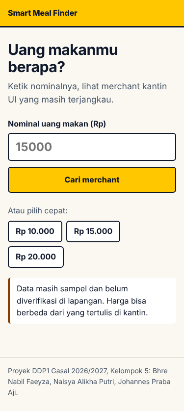
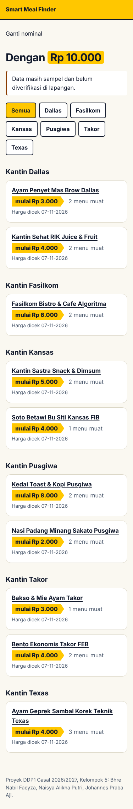
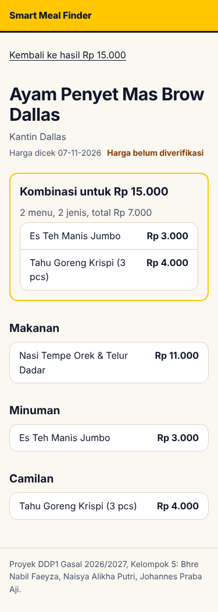

# Smart Meal Finder

Tugas Proyek Kelompok DDP1 Gasal 2026/2027, Universitas Indonesia, Kelompok 5.

Mahasiswa UI sering memutuskan makan dari uang yang tersisa, tetapi tidak ada satu tempat yang langsung menjawab merchant mana yang masih terjangkau. Smart Meal Finder menjawabnya dalam dua langkah: ketik nominal, lihat merchant kantin UI yang cukup, tanpa login dan tanpa JavaScript.

| Beranda | Hasil | Detail merchant |
|---|---|---|
|  |  |  |

## Status data (baca dulu)

Isi `data/merchants.json` masih **data sampel yang belum diverifikasi di lapangan**; aplikasi menampilkan peringatan itu kepada pengguna. Cara data dikumpulkan dan yang masih harus dilakukan ada di [`data/README.md`](data/README.md).

## Fitur versi 1

- Input nominal, tombol cepat 10.000, 15.000, 20.000; format `15.000` dan `15000` diterima.
- Hasil hanya memuat merchant yang punya minimal satu menu sampai nominal itu, dikelompokkan per kantin dan diurutkan menurut nama, tanpa skor.
- Jika tidak ada yang cukup: harga termurah yang ada dan selisihnya, bukan halaman kosong.
- Detail merchant: hanya menu yang muat, plus kombinasi menu yang mencakup jenis terbanyak dalam anggaran.
- Setiap merchant menampilkan tanggal harga dicek; lebih dari 30 hari diberi label. Status buka/tutup tampil jika jam buka tercatat (jam lewat tengah malam ditangani).
- Saring menurut kantin. Terang dan gelap mengikuti pengaturan perangkat.

Sengaja tidak ada: peta, jarak, ranking, login, pemesanan, ulasan. Alasannya ada di [`docs/SPEC-v2.md`](docs/SPEC-v2.md) dan [`docs/adr/0001-ikuti-rancangan-v1.md`](docs/adr/0001-ikuti-rancangan-v1.md).

## Menjalankan dari nol

Butuh Python 3.10 atau lebih baru.

```bash
git clone https://github.com/BhreKheley/TPA-DDP1.git
cd TPA-DDP1
python -m venv .venv
source .venv/bin/activate          # Windows PowerShell: .venv\Scripts\Activate.ps1
pip install -r requirements.txt
python run.py                      # buka http://127.0.0.1:5000
```

Opsi lewat variabel lingkungan: `PORT`, `HOST` (bawaan `127.0.0.1`), `FLASK_DEBUG=1` (bawaan mati).

## Pengujian

```bash
pip install -r requirements-dev.txt
python -m pytest -q                                   # 56 tes
python -m pytest --cov=core --cov=app --cov-report=term-missing
flake8 core app tests run.py --max-line-length=120
```

GitHub Actions menjalankan lint, validasi data, dan tes di Python 3.10 sampai 3.12 pada setiap push ke `main` dan pull request.

## Struktur

```
core/models.py    dataclass Merchant dan MenuItem, DataError
core/loader.py    memuat dan memvalidasi data/merchants.json
core/budget.py    filter anggaran, best_combo (DP), status buka; murni, tanpa Flask
app/              application factory, rute, templat Jinja, CSS
data/             merchants.json dan cara pengumpulannya
docs/             SPEC-v2.md, adr/, PR_REVIEWS.md (versi 1), img/
tests/            test_loader, test_budget, test_routes
```

Aliran satu permintaan: browser mengirim `GET /cari?nominal=...`; rute memvalidasi input, memanggil `core.budget`, lalu merender templat. Server tidak menyimpan data pengguna.

## Kombinasi menu (`best_combo`)

Dynamic programming atas status (jenis menu yang tercakup, biaya terpakai). Harga dibulatkan ke atas per kelipatan Rp 500 sehingga total tidak pernah melebihi anggaran. Dipilih kombinasi dengan jenis terbanyak, lalu total termurah. Contoh dari rancangan, anggaran Rp 15.000: nasi 4.000 + tempe 2.000 + es teh 3.000 = Rp 9.000 mencakup 3 jenis (ada di `tests/test_budget.py`).

## Tim

| Anggota | GitHub | Bidang |
|---|---|---|
| Bhre Nabil Faeyza | [@BhreKheley](https://github.com/BhreKheley) | Logika inti dan pengujian |
| Naisya Alikha Putri | [@naisyaalika](https://github.com/naisyaalika) | Data dan pengalaman pengguna |
| Johannes Praba Aji | [@Ojokz](https://github.com/Ojokz) | Aplikasi web dan CI |

Kontribusi tiap anggota dapat dilihat dari `git shortlog -sn`.

## Video demo

Tautan YouTube (maksimal 15 menit): belum ada, diisi setelah perekaman.

## Penggunaan AI

Sesuai panduan DDP1, AI (Claude) dipakai membantu penyusunan rancangan, penyelarasan kode V2 dengan rancangan, templat, dan tes. Setiap anggota tetap wajib memahami dan bisa menjelaskan semua modul tanpa membaca kodenya sebelum merekam video.

## Lisensi

Belum dipilih tim; tambahkan berkas `LICENSE` sebelum pengumpulan.
